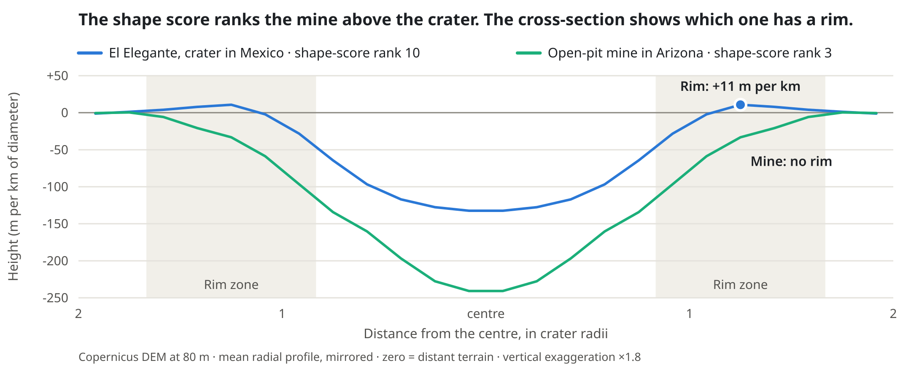

# MARSCEPTION

An open-data Earth-analog explorer and 2D rover game for preparing selected Moon and Mars operations.

**Public demo:** [project website](https://marsception.us/) · [rover game in English](https://v1.marsception.us/?lang=en). Deployment is managed by Mario. The current submission asset is the seven-slide PDF; the new recording and trailer follow [the English shot list](docs/media/TRAILER_GUION.md). PR #75 remains a draft.

Physics 2 models Bekker–Wong sinkage and Mohr–Coulomb traction with declared reference/simulant limits. Explore seven featured Earth levels, filter the catalog in **Discover**, and ask **ANA** about evidence: suggested questions work offline; optional live AI answers can be wrong. See [English methodology](docs/METHODOLOGY_EN.md) and [level rules](docs/juego/NIVELES_DESTACADOS.md).

NASA Space Apps 2026 · Monterrey / UDEM. Challenge: [Identify Earth Locations that Analog the Permanent Moon Base Locations and Mars](https://www.spaceappschallenge.org/2026/challenges/permanent-moon-base-locations-and-mars/).

**Submission slides:** [seven-page English PDF](docs/media/marsception_slides.pdf) · [editable PowerPoint](docs/media/marsception_slides.pptx) · [source and regeneration notes](docs/media/SLIDES_SOURCE.md). Video work is paused; PR #75 remains a draft. Edmundo confirms the official submission.

## What to explore

Inspect candidate Earth sites, their measurements, sources and limits in the web explorer. Build a rover within a 1,000-credit game budget, test it on Earth terrain and attempt a delivery on the Moon or Mars. Bundled data keep the game usable without a live API. Robot balance and added terrain features are declared game approximations, not evidence of field readiness.

Mexico is the validated case study. The global search covers Atacama, Arizona and Arabia: 3 of 10 prioritized arid regions, not the entire planet. Candidate status does not establish geological origin, novelty or permission to access a site.

## Key findings from the model

Each line is a separate check and answers a different question. The numbers come from [model/VALIDATION.md](model/VALIDATION.md) and the [notebooks below](#notebooks-and-how-to-check-the-numbers); none of them is a game value.

- **One detector, three worlds.** The same code finds crater-like closed depressions on Earth (Copernicus DEM), at the lunar south pole (LRO LOLA) and on Mars (HRSC+MOLA), all at 200 m per pixel, and measures diameter, depth-to-diameter (d/D) and rim height.
- **Moon and Mars craters can be told apart, and the main rule is d/D.** A logistic regression trained on 4,288 lunar and 573 Martian craters (6 Mars sites) reaches 77.6 % ± 0.2 % balanced accuracy with spatially grouped validation, and 75.8 % with d/D alone. On a Mars site it never saw: 70 % (Gale) to 92 % (Meridiani).
- **The gap is not only the instrument.** Blurring LOLA to MOLA's ~463 m effective resolution lowers the lunar d/D, but for craters of 2 km or more the Moon keeps more than twice the Martian d/D (0.051 vs 0.019) and accuracy stays at 77.6 % ± 0.7 %. Below 1–2 km, part of the separation may be instrumental ([model/NIVEL2.md](model/NIVEL2.md) §B).
- **The detector finds known craters, and its false positives are explained.** It finds 9 of 11 known Mexican craters. Of its 668 Mexican detections, 71 % fall in humid southern mountains: real sinkholes and ravines that match a crater's shape at 200 m. A bare-earth DEM (FABDEM) removes only 15 % of them, so they are not tree canopy; the arid mask (MODIS NDVI p90 < 0.35) does remove them. That leaves 47 arid candidates in Mexico and 296 after adding Atacama, Arizona and Arabia.
- **Shape alone does not prove a crater, and we report it.** All 8 detected terrestrial impact craters fall inside the 95 % Moon+Mars cloud, but so do 84 % of all 5,208 closed depressions found in Mexico. Among AI-labeled arid candidates, the shape score does not separate natural craters from dams, valleys and dunes (AUC 0.42, p = 0.43). Shape is used only to say how lunar or Martian an already-identified crater is.
- **The raised rim does separate craters from other hollows.** Impacts and explosive eruptions pile material around the hole; valleys, dams, dunes and open pits do not. With 80 m radial profiles ([model/borde.py](model/borde.py)), 10 of 11 externally sourced craters and 13 of 14 AI-labeled natural craters have a raised rim, against 3 of 26 dams, valleys and dunes and 4 of 38 open pits next to an OpenStreetMap quarry. Rim height separates both pairs with AUC 0.91 (p < 0.001), where the shape score gets 0.42 and 0.36. Ranked by rim, 7 of the 11 sourced craters land in the top 20 of the 296 candidates; ranked by shape, 2. Out of sample, 7 of 8 impact craters the rule had never seen have a raised rim.
- **AI labels say what each depression is, with stated uncertainty.** Of the 296 arid candidates, 27 are natural craters (9 %) and 53 mines or quarries (18 %); the rest are valleys (94), undecidable (57), dunes (22), dams or lakes (20) and other shapes. The labels were checked against external sources in 33 non-random cases, 29 correct (95 % CI 72–97 %); those cases are mines, volcanoes and Meteor Crater, so valley, dam and dune labels are unchecked. The detector finds crater-shaped closed depressions, not craters.
- **The environmental pre-filter discards but does not rank.** It sends 3 of 3 negative controls (Amazon, Congo basin, Mekong rice plain) to 0 through the vegetation veto and passes 9 of 21 known analogs; the ones that fail are analogs for reasons these variables cannot see (polar cold, water chemistry, caves, buried structures). On the detector's arid sites its score is narrow (median 0.41, 10th–90th percentile 0.32–0.52). Both destinations' day–night temperature range (Moon 176 K, Jezero 55 K) exceeds the terrestrial maximum of 40 K, so it is clipped there and declared.



**What the search turned up: candidates for review, not discoveries.**

- **Known analogs found again, as positive controls:** the El Pinacate craters (Apollo 14 crew training, 1970), Meteor Crater, and Colton Crater in Arizona (Apollo 15 training, 1970), which the detector found on its own.
- **Arabian volcanic craters:** the Jabal Bayda tuff cone (Harrat Khaybar) and the Al Wahbah maar were not found as Moon or Mars analogs in the literature we reviewed (Al Wahbah is published as an Enceladus analog). Not found is not the same as new. The Al Hutaymah maar lies in a volcanic field already listed in a 2024 global database of Mars-relevant hydrovolcanic sites (Ryan et al., *Geosphere*). It is the game's lunar golden-path site. Literature review: [model/NIVEL2.md](model/NIVEL2.md) §A.
- **Open-pit mines** in Mexico, Atacama and Arizona: an operational analog for extreme slopes, with the analogy broken by excess depth. They are known mines and are never marked novel.

**What we do not claim.** No Earth site reproduces the destination's gravity, vacuum, radiation or polar-shadow cold (about 40 K). Shape similarity says nothing about composition (the lunar south pole is anorthosite). The rim says "this is a crater", not "this is lunar": only 55 of 248 lunar reference craters show one with the same measure. The rim window was chosen after seeing the data, so every variant is reported.

## Run locally

Clone this repository and run each command from its root. Use a supported Node.js LTS, 22.12+ (or Node 24), and Python 3.12. Run web and game in separate terminals; Vite chooses another port if 5173 is occupied. Use the URL printed by each server.

```sh
git clone https://github.com/Niettzche/spaceapps-2026.git
cd spaceapps-2026
```

| Part | Command from the repository root |
|---|---|
| Rover game | `cd game && npm ci && npm run dev` |
| Web explorer | `cd web && npm ci && npm run dev` |
| Model / data validation | `pip install -r model/requirements.txt && python model/validate_data.py` |
| Model unit tests | `python -m pytest -q model/tests` |
| Optional model API | `pip install -r api/requirements.txt && uvicorn api.main:app --reload` |

For local game-to-web links, configure `VITE_WEB_URL` to the web server's printed URL before starting the game. `VITE_API_URL` is optional for the offline demo. These variables are public URLs; credentials do not belong in browser code.

## Test the complete path

See the header of [game/e2e/camino_dorado.mjs](game/e2e/camino_dorado.mjs) for Chromium, Playwright, development-server, screenshots and report setup. It exercises the actual scene UI for Earth testing and the lunar/Martian delivery routes. A passing build is not a substitute for this walkthrough or a physical-phone check.

## Build for the VPS

After installing dependencies in both `web/` and `game/`:

```sh
node web/scripts/build-demo.mjs
```

Upload `web/dist/`. It contains web `/`, game `/game/` and the video. `DEMO_BASE` supports subdirectory hosting; `VITE_WEB_URL`, `VITE_API_URL` and `VITE_GAME_URL` are coordinated by the build script. See [deployment instructions](web/DEPLOY.md). Mario manages publication to the public demo domain above.

The observed public routing on 15 November differs from that combined-build layout: the project site is at `https://marsception.us/`, and its Play button opens the game at `https://v1.marsception.us/`. `https://marsception.us/game/` returns 404. Preserve Mario's separate-host configuration; for a separate web build, set `VITE_GAME_URL=https://v1.marsception.us/`.

## Data and methodology

| Data | Provider and use |
|---|---|
| [MODIS](https://modis.gsfc.nasa.gov/data/) | NASA · vegetation, land cover, albedo |
| [NASA POWER](https://power.larc.nasa.gov/) | NASA · climate |
| [LRO LOLA](https://pds-geosciences.wustl.edu/missions/lro/lola.htm) | NASA · lunar elevation |
| [HRSC + MOLA](https://astrogeology.usgs.gov/search/map/mars_mgs_mola_mex_hrsc_blend_dem_global_200m) | ESA/NASA via USGS · Martian elevation |
| [Copernicus DEM GLO-30](https://dataspace.copernicus.eu/explore-data/data-collections/copernicus-contributing-missions/collections-description/COP-DEM) | ESA · Earth elevation |
| [NASA GIBS](https://www.earthdata.nasa.gov/eosdis/science-system-description/eosdis-standard-services/gibs) | NASA · basemap imagery |
| [GVP](https://volcano.si.edu/) / [OpenStreetMap](https://www.openstreetmap.org/copyright) | Smithsonian / OSM contributors · external landform checks |

The detector compares Earth, Moon and Mars at 200 m resolution. See [methodology in English](docs/METHODOLOGY_EN.md), [metodología en español](docs/METODOLOGIA.md), [model validation](model/VALIDATION.md) and the [provisional shortlist](ciencia_datos/salidas/lista_corta.md). Surface interpretations, missing values, uncertainty and scientific limits remain explicit.

### Notebooks and how to check the numbers

The notebooks are in Spanish and already executed, so GitHub shows their tables and figures without running anything.

| Where | What it shows |
|---|---|
| [`analisis/`](analisis/README.md) `00`–`26` | Earth Engine / Colab pipeline: arid mask, Moon and Mars references, the depression detector, validation (9 of 11), the FABDEM experiment, the global search (Atacama, Arizona, Arabia), 80 m radial profiles, polar illumination and the game's real-relief levels |
| [`ciencia_datos/01`](ciencia_datos/01_modelos_explicables.ipynb) | Decision tree and logistic regression that separate Moon, Mars and Earth craters |
| [`ciencia_datos/02`](ciencia_datos/02_diagnostico_y_mejoras.ipynb) | Why Earth labels were the bottleneck; the Moon-versus-Mars score plus distance to the reference cloud |
| [`ciencia_datos/03`](ciencia_datos/03_etiquetas_por_fuentes.ipynb) | Earth labels from citable sources (70-crater volcanic catalog, OpenStreetMap quarries) and the score for every Mexican detection |
| [`ciencia_datos/04`](ciencia_datos/04_fichas_explicables.ipynb) | Per-site card: each variable's exact contribution and the 3 nearest lunar and Martian twins |
| [`ciencia_datos/05`](ciencia_datos/05_fichas_integradas.py) | Joins shape, profile against the lunar twin, polar shadow, ASTER geology, NASA POWER climate and the AI label into the [shortlist](ciencia_datos/salidas/lista_corta.md) |
| [`ciencia_datos/06`](ciencia_datos/06_modelo_luna_marte.ipynb) | The 78 % model step by step: grouped validation, confusion matrices, coefficients, unseen Mars sites |
| [`ciencia_datos/etiquetado_ia/`](ciencia_datos/etiquetado_ia/) | AI terrain labeling on Sentinel-2 imagery and relief, and its external check (29 of 33) |
| [`informe/exposicion_modelo/01`](informe/exposicion_modelo/01_borde_levantado.ipynb) | The raised-rim measure, its separation, its sensitivity and the out-of-sample impact craters |
| [`informe/exposicion_modelo/02`](informe/exposicion_modelo/02_cifras_de_la_guia.ipynb) | Recomputes every figure the repository data allow; its last cell fails if a number no longer matches `model/VALIDATION.md` |

Reports (Spanish): [detector validation](informe/validacion_detector.pdf) · [explainable models](informe/modelos_explicables.pdf) · [model study guide](informe/exposicion_modelo/guia_exposicion_modelo.pdf).

The `ciencia_datos` and `exposicion_modelo` notebooks download nothing. Re-run them with pinned versions (other scikit-learn versions move the shape score in the third decimal):

```sh
uv run --with scikit-learn==1.5.2 --with pandas==2.2.3 --with numpy==2.1.3 --with jupyter \
  jupyter lab informe/exposicion_modelo/01_borde_levantado.ipynb
```

The `analisis/` pipeline needs a Google Earth Engine account.

## AI disclosure and project files

Claude Code and Codex assisted code and documentation. Mauricio created MARSCEPTION artwork with Claude. Claude also assisted image-based terrain labeling; 29/33 externally checked, non-randomly selected cases were correct. This does not estimate accuracy over all candidates. Full declaration: [USO_IA.md](docs/USO_IA.md).

- `analisis/`, `ciencia_datos/`, `model/`: detection, explainable analysis and validation.
- `data/`: versioned sites, targets and schemas; `api/`: optional model service.
- `web/`: public explorer; `game/`: Phaser/Matter rover game; `assets/`: artwork.
- [English submission draft](docs/ENTREGA_EN.md) · [pitch](docs/GUION_PITCH.md) · [team instructions](AGENTS.md).

Repository visibility is currently private. The repository owner must make it public before judging; public demo/video links and official submission must be verified separately.
## Art credits
- MARSCEPTION art (sprites, backgrounds, terrain, UI, title screen): original, generated with code in `assets/fuente/` (AI-assisted, see `docs/USO_IA.md`). See [assets/README.md](assets/README.md).
- **[pixelfx](https://github.com/patch-gg/pixelfx)**: MIT license, Copyright (c) 2026 Patch and Copyright (c) 2026 Hugo Duprez.
  The effects (`assets/fx/`) are pixelfx effects written for the game (`assets/fuente/fx/`); the rest of the art is drawn with its painter and color ramps.
  Its `mini` and `big` fonts are MIT; its "Patch Pixel" font is not and is not used.
  The game's bitmap fonts (`assets/fuentes/`) take their capitals and digits from pixelfx's MIT `big` font; lowercase, accents and symbols are original.
