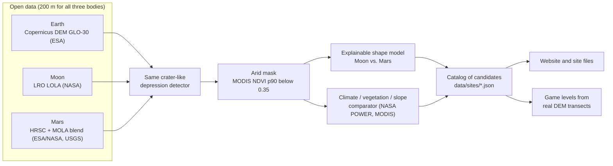

# MARSCEPTION

**Train on Earth. Land on the Moon / Mars.**

MARSCEPTION searches Earth for places shaped like craters at the lunar south pole and at Jezero Crater on Mars, using open NASA and ESA data. It then lets you test a rover on those places in a 2D game before you send it to the Moon or Mars. Every comparison states its source, and every site states where the analogy breaks.

NASA Space Apps Challenge 2026 · Monterrey local event (UDEM) · Challenge: [Identify Earth Locations that Analog the Permanent Moon Base Locations and Mars](https://www.spaceappschallenge.org/2026/challenges/permanent-moon-base-locations-and-mars/)

| Start here | Link |
|---|---|
| Play the rover game (English) | <https://v1.marsception.us/?lang=en> |
| Project website: trailer, crater quiz, method, ANA tutor | <https://marsception.us/?lang=en> |
| 30-second trailer (English captions) | <https://marsception.us/?lang=en#trailer> |
| One-page methodology | [docs/METHODOLOGY_EN.md](docs/METHODOLOGY_EN.md) |
| Key figures, one line each, with sources | [docs/PITCH_CIFRAS_EN.md](docs/PITCH_CIFRAS_EN.md) |
| Model validation report (Spanish, generated by `model/validate.py`) | [model/VALIDATION.md](model/VALIDATION.md) |
| Seven-slide deck | [docs/media/marsception_slides.pdf](docs/media/marsception_slides.pdf) |
| Answers to likely judge questions | [docs/PITCH_QA_EN.md](docs/PITCH_QA_EN.md) |

---

## Contents

1. [The idea in one minute](#1-the-idea-in-one-minute)
2. [Try it in five minutes](#2-try-it-in-five-minutes)
3. [How the analog search works](#3-how-the-analog-search-works)
4. [Validation: what each number answers](#4-validation-what-each-number-answers)
5. [What we found (and what we do not claim)](#5-what-we-found-and-what-we-do-not-claim)
6. [The game](#6-the-game)
7. [Game physics and where each value comes from](#7-game-physics-and-where-each-value-comes-from)
8. [Where the analogy breaks](#8-where-the-analogy-breaks)
9. [Data sources](#9-data-sources)
10. [Repository map](#10-repository-map)
11. [Run it locally](#11-run-it-locally)
12. [Tests and quality checks](#12-tests-and-quality-checks)
13. [Build and deployment](#13-build-and-deployment)
14. [Limitations and future work](#14-limitations-and-future-work)
15. [AI use disclosure](#15-ai-use-disclosure)
16. [Credits and licenses](#16-credits-and-licenses)

---

## 1. The idea in one minute

Analog sites let teams rehearse part of a lunar or Martian mission on Earth: driving on loose sand, crossing lava blocks, working inside a crater. No place on Earth matches the Moon or Mars in everything, so the useful question has two halves:

- **Where on Earth is most like this place, and how alike is it?**
- **What can that place *not* teach us?**

MARSCEPTION answers both halves with two connected parts:

1. **An analog finder (the core).** One crater-detection code runs on Earth, the lunar south pole and Mars at the same 200 m resolution. An explainable statistical model trained on real lunar and Martian craters then measures how Moon-like or Mars-like each Earth depression is. A transparent climate, vegetation and slope comparator complements it. The output is a catalog of **candidates for review**, each with measurements, sources and stated limits.
2. **A rover game (the experience).** You pick the Moon or Mars, open the "site file" of a real Earth analog, build a robot with a fixed budget, and drive it over that site's real elevation profile. You fail, read feedback based on what actually happened, redesign, and finally deliver cargo under real lunar or Martian gravity. The results screen lists what the Earth test could not show.

> "The information already exists; the point is to experiment with it in a controlled environment."

---

## 2. Try it in five minutes

Open <https://v1.marsception.us/?lang=en> on a computer or a phone. No account, install or API is needed; the game ships with its data.

**Mars route (Samalayuca dunes, Mexico → Jezero Crater)**

1. Choose **Mars**. Open the site file of **Samalayuca**: Earth on the left, Jezero on the right, same variable and unit, and the differences that will remain untested.
2. Spend one of your **3 test tickets** and go to the **workshop**. Build with **standard wheels**.
3. **Earth test on the dunes:** the standard wheels slip and sink. Feedback suggests wider wheels.
4. Switch to **wide wheels** and test again: the robot gets through.
5. **Launch the mission:** deliver the cargo at Jezero under 3.71 m/s². See your score and the "what Earth could not test" list.

**Moon route (Al Hutaymah maar, Saudi Arabia → lunar south pole)**

The same loop. In the Al Hutaymah maar (`g00263`), standard wheels sink and stall and wide wheels pass. The mission then runs under 1.62 m/s² at an Artemis candidate region near the lunar south pole.

**Keyboard:**
- Site file: C opens the full site conditions.
- Workshop: drag parts, or use Tab / arrows / Enter; Delete removes a part; H opens help.
- Driving: → or D to accelerate, ← or A to brake, Esc to pause, I for the data panel, ? for the guide, M to mute effects. Music has its own on-screen control.

Touch controls appear on phones. The repository also includes a phone-as-gamepad relay ([control-celular/](control-celular/)) for local use; it is not deployed on the public demo.

---

## 3. How the analog search works



### 3.1 One detector, three worlds

The detector ([analisis/](analisis/), Google Earth Engine) looks for closed, crater-like depressions in elevation models. It runs with **the same code at the same 200 m per pixel** on:

| Body | Elevation data | Native resolution |
|---|---|---|
| Earth | Copernicus DEM GLO-30 (ESA) | 30 m, resampled to 200 m |
| Moon, south pole | LRO LOLA `ldem_80s_80m` (NASA) | 80 m, resampled to 200 m |
| Mars | HRSC + MOLA blended DEM (ESA/NASA, via USGS) | 200 m |

For every depression it measures **diameter, depth, depth-to-diameter ratio and rim height**. Because the measurement is identical on all three bodies, an Earth hollow and a lunar crater can be compared number to number, not by how they look in a picture.

### 3.2 Arid mask

In Mexico the detector produced 668 detections. **71 %** of them were real sinkholes and ravines in humid mountains: real landforms that meet the shape rule at 200 m but are not useful crater analogs. A bare-earth DEM (FABDEM) removes only 15 % of them, so they are not tree canopy. We therefore keep only arid terrain, using **NASA MODIS vegetation (NDVI 90th percentile < 0.35)**. That leaves **47 arid candidates in Mexico**.

The global search then scanned one 600 × 600 km box in each of **3 other prioritized arid regions: Atacama, Arizona and western Arabia**. With Mexico, the total is **296 arid candidates** (Mexico 47, Atacama 171, Arizona 45, Arabia 33). Six prioritized regions are not scanned yet: Sahara, interior Australia, Gobi, Kalahari, Iranian plateau and Thar. We do not claim to have scanned the whole planet.

### 3.3 Explainable shape model (Moon vs. Mars)

A **logistic regression** ([ciencia_datos/](ciencia_datos/)) is trained on **4,288 lunar and 573 Martian craters** from 6 Mars sites, all measured by the same detector:

- About **78 % balanced accuracy** with **spatially grouped validation**: nearby craters never sit on both sides of a training/testing split.
- **76 %** using depth-to-diameter alone, its most influential variable.
- **70–92 %** on a Mars site the model never saw (70 % at Gale, 92 % at Meridiani).

Each Earth depression gets a Moon-or-Mars score and a distance to the Moon + Mars reference crater cloud. This is a transparent statistical model, **not a neural network**, and it did not "discover" anything on its own. At 200 m the lunar rim measurement is unreliable (median −23 m), so the rim is not used as evidence of lunar similarity.

### 3.4 Complementary comparator

The comparator ([model/score.py](model/score.py)) compares each Earth site with the destination profile ([data/targets/](data/targets/)), variable by variable, with the same units:

| Dimension | Earth source | Weight (P) | Scale (P) |
|---|---|---|---|
| Crater shape | Detector + shape model | 0.40 | — |
| Daily temperature range | NASA POWER `T2M_RANGE` | 0.20 | 20 K |
| Precipitation | NASA POWER `PRECTOTCORR` | 0.15 | 1 mm/day |
| Vegetation (NDVI) | MODIS MOD13Q1 | 0.10 | 0.15, **veto** if dense |
| Slope | DEM | 0.15 | 5° |

- **Per-dimension similarity:** `s = exp(−|earth − target| / scale)`.
- **Total:** weighted geometric mean of the dimensions. Dense vegetation vetoes a site.
- **Out-of-range targets:** when the destination is outside the Earth range (for example the lunar day–night swing), the value is clipped to the Earth extreme and the clip is recorded in `limites`.
- **Missing data:** the dimension is skipped, the remaining weights are renormalized and `confianza` (data coverage, not mission success) drops.
- **Destination values:** Jezero uses Perseverance MEDA measurements; the lunar south pole uses LRO Diviner (temperature) and LRO LOLA (slope). Every value keeps its source, date and unit.

(P) marks a provisional value chosen by the team, not a measurement.

### 3.5 From catalog to game level

Each site file (`data/sites/<id>.json`, validated against [data/schema/](data/schema/)) stores its measurements, similarity per dimension, limits and a **level**:

- The level terrain is a **real window of a Copernicus GLO-30 elevation transect** (most are 250 m; they range from 180 to 530 m), never stretched.
- Features the DEM cannot resolve, such as dune slip faces and ~0.3 m rocks, are added as **declared recreations** (`recreacion: true`). A recreated dune face never exceeds 30°, the lower bound of the angle of repose of dry sand ([Pelletier et al. 2015](https://doi.org/10.1002/2015JF003636)).

The catalog holds 63 site files today: 57 model candidates and 6 documented sites, across Mexico, the USA, Chile, Saudi Arabia, Mauritania, Algeria, Namibia and Canada.

---

## 4. Validation: what each number answers

These are separate checks. Each answers a different question, and they are not interchangeable.

| Check | Result | What it shows | Source |
|---|---|---|---|
| Known Mexican craters | **9 of 11** found | The detector finds real craters | `ciencia_datos/03`, [informe/validacion_detector.pdf](informe/validacion_detector.pdf) |
| Terrestrial impact craters vs. Moon + Mars cloud | **8 of 8** inside the 95 % cloud | Real impact craters have planetary-like shape | [model/VALIDATION.md](model/VALIDATION.md) |
| Moon vs. Mars classification | **~78 %** balanced accuracy, spatially grouped | Shape carries a real Moon/Mars signal | `ciencia_datos/03` |
| Negative controls: Amazon rainforest, Congo Basin, Mekong rice plain | **3 of 3** score 0 | The comparator rejects non-analogs | [model/VALIDATION.md](model/VALIDATION.md) |
| Known analogs (21, e.g. Atacama, Haughton, Death Valley, MDRS) | **9 of 21** pass the 0.4 threshold | The comparator sees aridity and bare ground. It misses analogs chosen for other reasons (cold, lava, chemistry) | [model/VALIDATION.md](model/VALIDATION.md) |
| AI-assisted landform labels | **29 of 33** correct vs. external sources | Labels are useful, on a **non-random** sample | [validacion.txt](ciencia_datos/etiquetado_ia/validacion.txt) |

**A limit we found and kept.** Among arid candidates, the Moon/Mars shape score alone does **not** separate natural craters from other closed depressions such as dams, valleys or dune hollows (AUC 0.42). **Rim height does** (AUC 0.91, p < 0.001; 10 of 11 externally sourced craters have a raised rim). So the catalog uses a verified label to decide *what* a depression is, and uses shape only to say *how* Moon-like or Mars-like a confirmed crater is. Details: [model/VALIDATION.md](model/VALIDATION.md).

---

## 5. What we found (and what we do not claim)

We found **candidates for review, not discoveries**. No site in the catalog is flagged as novel.

- **A check on the method.** The scanned regions were chosen partly because they contain known control sites. Within them, without being told where to look, the detector picked out **El Pinacate** (Sonora, Mexico), where the Apollo 14 crew trained in February 1970 (Phinney 2015, NASA SP-2015-626), and **Colton Crater** (Arizona), where the Apollo 15 crew trained in July 1970 (USGS OFR 2005-1190). That supports the method; it is not a finding.
- **Proposed for expert review, without calling them new:**
  - **Jabal Bayda tuff ring** (Harrat Khaybar, Saudi Arabia). We did not find it used as a Moon or Mars analog in the literature we reviewed, and it is not in the global database of Ryan et al. (2024, *Geosphere*). That database covers only basaltic fields and is not exhaustive.
  - **Al Wahbah maar** (Harrat Kishb, Saudi Arabia). It is published as an Enceladus analog (2024, *Astrobiology*), but we did not find it used for the Moon or Mars. We propose it for the Moon.
- **Open-pit mines as operational analogs, not geological ones.** Mines such as Cananea are useful for testing steep walls, excavation and shadowed floors. The shape comparison breaks there: they are stepped, artificial holes, and the deepest exceed almost any lunar crater of their size.
- **What the 296 candidates are.** By the AI label, 27 are natural craters and 53 are mines or quarries. The rest are valleys, dams, dunes, other forms, or cases that cannot be decided.

"Not found" means not found in the literature we reviewed, not that nobody has used it. Literature review: [model/NIVEL2.md](model/NIVEL2.md), section A.

---

## 6. The game

Built with **Phaser 3 + Matter.js**, pixel-art side view, English and Spanish.

### 6.1 Player flow

`Loading → Menu (Moon or Mars) → Site file → Workshop → Earth test → Results and feedback → Mission → Score`

- **Site file.** A one-to-one comparison of the site you are about to test: same variable, same unit, its source, and what will remain untested.
- **Workshop.** 23 parts in 6 systems on a chassis with fixed slots; position matters. The budget is 1,000 credits (P), and you cannot start over budget.
  - Mobility: standard, wide, lugged, mesh and nitinol wheels.
  - Structure: light, reinforced, titanium and carbon chassis.
  - Energy: small, medium and large batteries.
  - Power: efficient, balanced and powerful motors.
  - Cargo: basic, strapped and damped mounts.
  - Modules: solar panels, battery heater, radiator and self-rescue.
- **Earth test.** You drive the real elevation profile under Earth gravity. You lose on destruction, lost cargo or an empty battery.
- **Feedback.** Rule-based suggestions tied to events that actually happened: slipping, sinking, impacts, energy use.
- **Mission.** The same robot runs under destination gravity. You win when the cargo reaches the base with **≥ 60 % integrity** (P).
- **Score (game value, not evidence).** 500 for delivery + cargo integrity × 3 + energy left × 1 + budget saved × 1 (each in %), up to 1,000. One star for delivery, two from 750, three from 900.

### 6.2 Seven featured Earth tests

Each has different terrain and hazards, and each rewards a specific design choice. Recommendations are game balance, not certified equipment choices. Rules and sources: [docs/juego/NIVELES_DESTACADOS.md](docs/juego/NIVELES_DESTACADOS.md).

| Level | What it is | Design decision it rewards |
|---|---|---|
| Jabal Bayda (Saudi Arabia) | Tuff ring | Wide or mesh wheels |
| Tenoumer (Mauritania) | 1.9 km impact crater in the Sahara, with dust devils | Mesh wheels + strapped cargo mount |
| Cananea (Mexico) | Open-pit mine (operational analog) | Mesh wheels |
| Pinacate (Mexico) | Lava field where the Apollo 14 crew trained | Reinforced or titanium chassis |
| Pingualuit (Canada) | 3.4 km impact crater, −34 °C winter lows (NASA POWER) | Mesh wheels |
| Samalayuca (Mexico) | Wind-built dunes (Mars golden path) | Wide wheels |
| Rincón de Parangueo (Mexico) | Dry maar lake | Medium or large battery |

In total, 16 Earth levels use real relief.

### 6.3 Discover and ANA

- **Discover** maps the catalog by type (impact crater, volcano or maar, open-pit mine, dunes, unverified depression). Its "Why here?" panel explains how each place entered the catalog, what its measured shape supports and what is missing. It reads existing evidence; it does not certify a site.
- **ANA, the analog tutor**, explains the method, the evidence and its limits. Suggested questions use deterministic answers that work offline. Free questions use an optional server-side OpenAI model (`gpt-5.4-mini` by default) with project data as context ([api/tutor.py](api/tutor.py)); the key stays on the server; those answers are labeled as AI and can be wrong. ANA is separate from the statistical model and does not validate sites.

---

## 7. Game physics and where each value comes from

Real values carry a source; game values are marked **(P)**. Full list: [docs/taller/FUENTES_FISICA.md](docs/taller/FUENTES_FISICA.md) and [docs/juego/FISICA_V2.md](docs/juego/FISICA_V2.md).

**Traction (physics v2, default).**
- Each wheel's maximum thrust is Mohr–Coulomb: **H = A·c + W·tan φ**, with W = m·g / wheels.
- The contact area A comes from **Bekker–Wong sinkage**, p = (k_c/b + k_φ)·zⁿ, for a rigid wheel.
- A wider wheel presses less, sinks less and pushes more.
- The engine's friction is **μ = 1.7 × tread^1.5 × H/W**. The per-part tread factor and the 1.7 calibration are **game values (P)**: for example, on sand the standard wheel's tread factor is 0.4 and the wide wheel's is 0.9 ([parts.json](game/src/content/parts.json)). Part effects therefore combine the soil equations with declared game values.

**Soil parameters.**

| Surface | Values | Source |
|---|---|---|
| Lunar regolith (top 15 cm) | c 0.52 kPa, φ 42° | Lunar Sourcebook (Carrier et al. 1991, from Costes et al. 1972, NASA TR R-401). Bekker values are Apollo LRV design values, not measurements |
| Martian drift | c 1.6 kPa, φ 18° | Viking (Moore 1991) |
| Martian sinkage | M90 simulant | Oravec et al. 2020, [NASA NTRS 20200003046](https://ntrs.nasa.gov/citations/20200003046). A simulant, not real Martian soil |
| Martian crusted soil / rock | φ 34.5° / 40–60° | Viking |
| Earth dry sand | Generic | Wong 2001, via [NASA/TM-20250006958](https://ntrs.nasa.gov/citations/20250006958). Not measured at the site |
| Earth cinder (loose) | c 0, φ 28.5° | See [FUENTES_FISICA.md](docs/taller/FUENTES_FISICA.md) |
| Earth compacted soil | φ 38° | NAVFAC DM-7.02 |
| Earth rock | μ ≈ 0.7 | (P): no measured tire–rock value |

**Gravity.** Earth 9.81, Mars 3.71 ([NASA JPL](https://ssd.jpl.nasa.gov/planets/phys_par.html)) and Moon 1.62 m/s². The engine scales all three by one common factor, so the real ratios are kept. Destination gravity is used **only** in the mission, never on the Earth analog.

**Climate and light.** NASA POWER supplies site climate (temperature, insolation). Jezero uses Perseverance MEDA; for example, a passing dust devil cuts sunlight by about 1 %.

**Mission autonomy (P).** On the Moon and Mars the robot slows itself over each recreated rock, as rover autonomous navigation does, to a speed at which the bump would not lift the cargo over its support wall: v ≤ k·√(2gH) / sin α.

---

## 8. Where the analogy breaks

No place on Earth reproduces these. Every site file states them, and the mission results screen lists the ones that apply to the destination:

- **Destination gravity**: the Earth test runs at 9.81 m/s².
- **Vacuum and air pressure**: about 718 Pa at Jezero vs. about 100,000 Pa on Earth.
- **Radiation**.
- **Polar-shadow cold** at the lunar south pole.

The terramechanics also have declared gaps:

- No Bekker parameters have been measured for real lunar regolith or Martian soil.
- The shear-deformation modulus (slip-dependent thrust), bulldozing and dynamic load transfer are not modeled.

Field access, permits and operational suitability need separate review. A high similarity does not certify geological origin or mission readiness.

---

## 9. Data sources

**NASA and other space-agency data**

| Data | Provider | Used for |
|---|---|---|
| [LRO LOLA](https://pds-geosciences.wustl.edu/missions/lro/lola.htm) | NASA | Lunar south pole elevation, crater shape |
| [HRSC + MOLA blended DEM, 200 m](https://astrogeology.usgs.gov/search/map/mars_mgs_mola_mex_hrsc_blend_dem_global_200m) | ESA/NASA via USGS | Mars elevation, crater shape |
| [MODIS](https://modis.gsfc.nasa.gov/data/) (MOD13Q1 and others) | NASA | Vegetation mask and veto, land cover, albedo |
| [NASA POWER](https://power.larc.nasa.gov/) | NASA | Daily temperature range, precipitation, insolation, level climate |
| Perseverance MEDA | NASA | Jezero temperature range, pressure, dust devils |
| LRO Diviner | NASA | Lunar south pole temperature range |
| [NASA GIBS](https://www.earthdata.nasa.gov/engage/open-data-services-software/earthdata-developer-portal/gibs-api) | NASA | Basemap imagery |
| [Copernicus DEM GLO-30](https://dataspace.copernicus.eu/explore-data/data-collections/copernicus-contributing-missions/collections-description/COP-DEM) | ESA (not a NASA product) | Earth elevation, crater shape, level terrain |

**Other sources**

- [Smithsonian Global Volcanism Program](https://volcano.si.edu/) and cited crater literature: external landform checks.
- [OpenStreetMap contributors](https://www.openstreetmap.org/copyright): quarries and open-pit mines.
- [OpenLandMap](https://openlandmap.org/) soil sand fraction: surface classes, with declared rules.
- Apollo regolith ([NASA NTRS 20220014634](https://ntrs.nasa.gov/citations/20220014634)) and Viking soil properties ([NASA NTRS 20200003046](https://ntrs.nasa.gov/citations/20200003046)).
- Sentinel-2 imagery: input to AI-assisted landform labels only.

Each site record keeps the article, unit, date and limitation of every measurement. A workbook with every sourced number (S-IDs) is at [docs/taller/Space_Apps_Game_Data.xlsx](docs/taller/Space_Apps_Game_Data.xlsx).

---

## 10. Repository map

| Folder | What it contains |
|---|---|
| [analisis/](analisis/) | Earth Engine cells: the crater-like depression detector for Earth, the lunar south pole and Mars (200 m) |
| [ciencia_datos/](ciencia_datos/) | Explainable models (Moon vs. Mars), outputs, AI-label procedure and check |
| [model/](model/) | Scoring (`score.py`), validation (`validate.py` → `VALIDATION.md`), export to `data/sites/`, unit tests |
| [data/](data/) | Data contracts (`schema/`), destination profiles (`targets/`), site files (`sites/`), known analogs list |
| [api/](api/) | Optional FastAPI service: `POST /score`, `POST /submit`, ANA tutor |
| [game/](game/) | Phaser 3 + Matter.js rover game (Vite), physics, levels, feedback, end-to-end tests |
| [informe/](informe/) | Project website (`divulgacion/`), detector and model validation reports (PDF) |
| [web/](web/) | React + MapLibre explorer and the combined build script |
| [assets/](assets/) | Original pixel art and the code that generates it |
| [control-celular/](control-celular/) | Optional phone-as-gamepad relay (Node.js WebSocket) |
| [docs/](docs/) | Methodology, pitch, decisions, physics and level sources, AI disclosure |

---

## 11. Run it locally

Use Node.js 22.12+ (or 24) and Python 3.12. Run each command from the repository root, with the web and the game in separate terminals.

```sh
git clone https://github.com/Niettzche/spaceapps-2026.git
cd spaceapps-2026
```

| Part | Command |
|---|---|
| Rover game | `cd game && npm ci && npm run dev` |
| Web explorer | `cd web && npm ci && npm run dev` |
| Model / data validation | `pip install -r model/requirements.txt && python model/validate_data.py` |
| Model unit tests | `python -m pytest -q model/tests` |
| Optional model API | `pip install -r api/requirements.txt && uvicorn api.main:app --reload` |

The game runs fully on its bundled JSON data. `VITE_API_URL` is optional. Set `VITE_WEB_URL` to the web server's URL for game-to-web links. These are public URLs; credentials never go in browser code. API keys (ANA's AI service) live only in the server's `.env`.

---

## 12. Tests and quality checks

- **Golden path, end to end:** [game/e2e/camino_dorado.mjs](game/e2e/camino_dorado.mjs) (Playwright + Chromium) plays the real scene UI for both the Mars and the Moon routes. Setup instructions are in its header.
- **Physics and level tests:** `game/src/fisica/*.test.mjs` (soil model, featured levels, decoration).
- **Model tests:** `python -m pytest -q model/tests`.
- **Data contracts:** `python model/validate_data.py` checks every `data/` JSON against [data/schema/](data/schema/).
- **CI:** [.github/workflows/validar.yml](.github/workflows/validar.yml) validates data, runs the model tests and builds the game on every pull request.

---

## 13. Build and deployment

After installing dependencies in `web/` and `game/`:

```sh
node web/scripts/build-demo.mjs
```

This produces `web/dist/` with the web at `/` and the game at `/game/`. See [web/DEPLOY.md](web/DEPLOY.md).

The public deployment uses separate hosts: the project website at <https://marsception.us/> and the game at <https://v1.marsception.us/>. For a separate web build, set `VITE_GAME_URL=https://v1.marsception.us/`.

---

## 14. Limitations and future work

**Current limitations**

- **Search coverage:** 3 of 10 prioritized arid regions, plus Mexico.
- **Validation:** some samples are small or non-random (8 impact craters, 33 checked AI labels); the reports say so.
- **Shape limits:** shape alone does not identify a crater (see §4), and the 200 m lunar rim is unreliable.
- **Comparator coverage:** it misses analogs chosen for cold, lava or chemistry (9 of 21 known analogs pass).
- **Terramechanics:** it uses reference and simulant soils, not site measurements.
- **Weights and thresholds:** all are provisional (P).

**Next steps**

- Scan the remaining arid regions: Sahara, interior Australia, Gobi, Kalahari, Iranian plateau and Thar.
- Add rim height to the shape score.
- Review user-proposed sites (`POST /submit` already stores them as pending).
- Field-check the top candidates with geologists.
- Add habitat and station modules to the workshop.

---

## 15. AI use disclosure

We used **Claude Code** and **OpenAI Codex** to assist software development, debugging, integration, testing and documentation. The MARSCEPTION artwork was created by a team member with Claude's assistance; artwork and effects are presentation assets, not scientific observations or topographic reconstructions.

For data review, Claude suggested landform labels for 298 arid candidates from Sentinel-2 images, shaded relief and measurements, with names and mine distances withheld. The integrated analysis uses 296 of them, after removing two duplicates. An external check found 29 of 33 non-randomly selected cases correct (88 %); this is not an accuracy estimate for all candidates. ANA's optional live answers come from an OpenAI model and are labeled as AI.

NASA, ESA and other measurements were not invented or replaced by AI output. Missing measurements stay missing. The team reviewed code, claims, labels and deliverables. The analog-shape model is an explainable statistical model, separate from the AI assistance. Full declaration: [docs/USO_IA.md](docs/USO_IA.md).

---

## 16. Credits and licenses

- **Art:** original MARSCEPTION pixel art (sprites, backgrounds, terrain, UI, title screen), generated with code in [assets/fuente/](assets/fuente/) and AI-assisted (see §15). Details: [assets/README.md](assets/README.md).
- **Title voice:** a team member's own recording, edited.
- **Music:** tracks provided by team members.
- **[pixelfx](https://github.com/patch-gg/pixelfx):** MIT License, © 2026 Patch and © 2026 Hugo Duprez.
- **Data:** credited to each provider in §9. MARSCEPTION is not affiliated with or endorsed by NASA or ESA, and uses no agency logos.

NASA Space Apps Challenge 2026 · Monterrey (UDEM).
