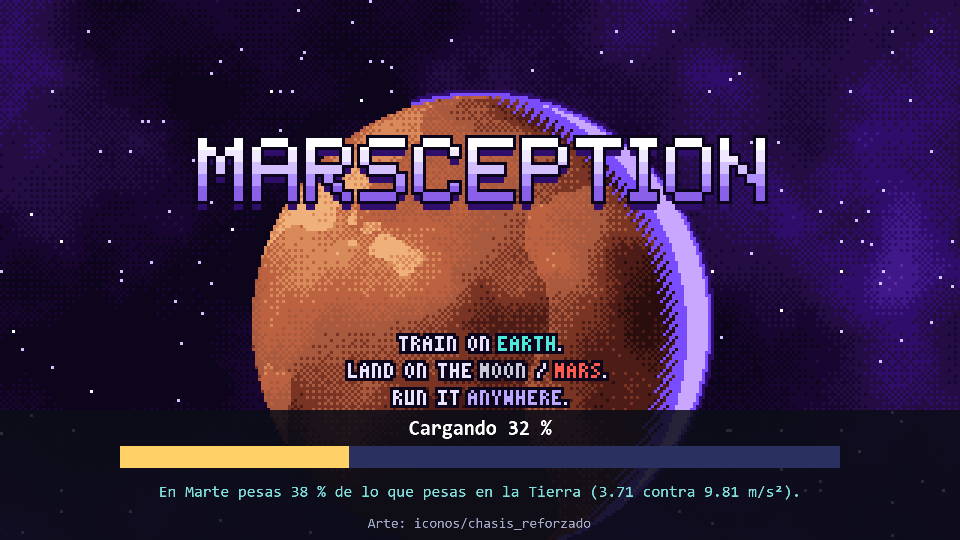
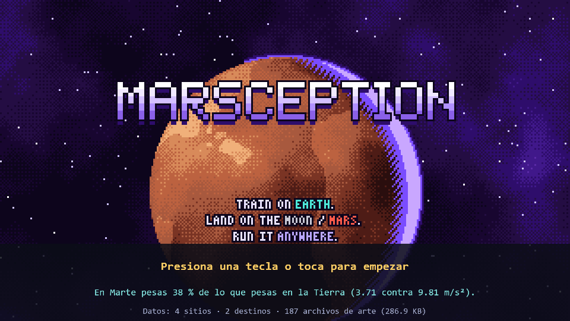
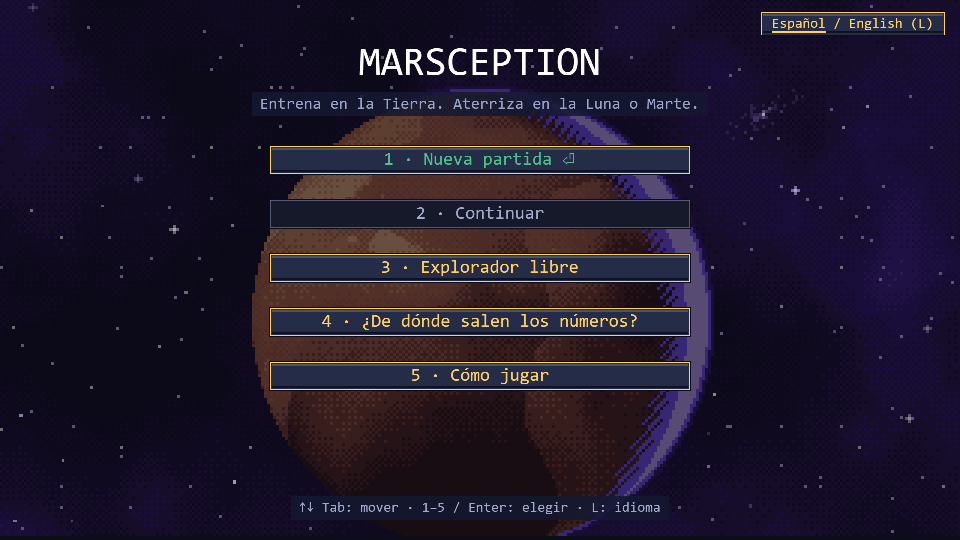
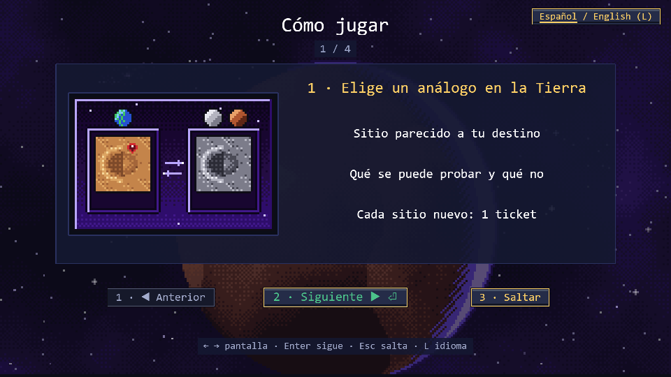
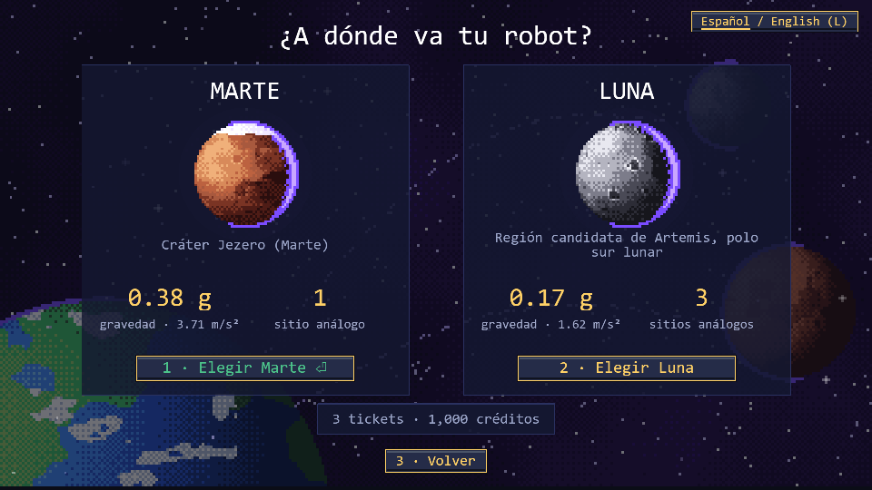
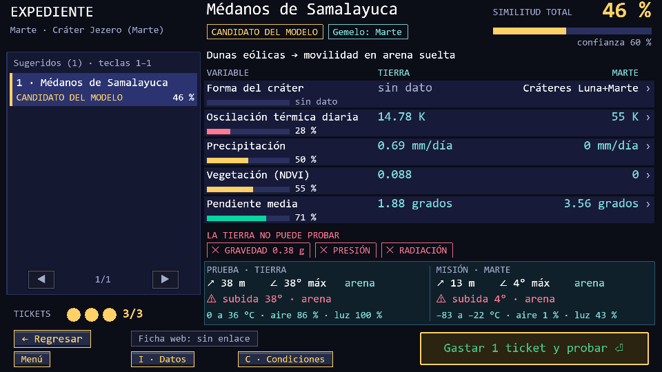
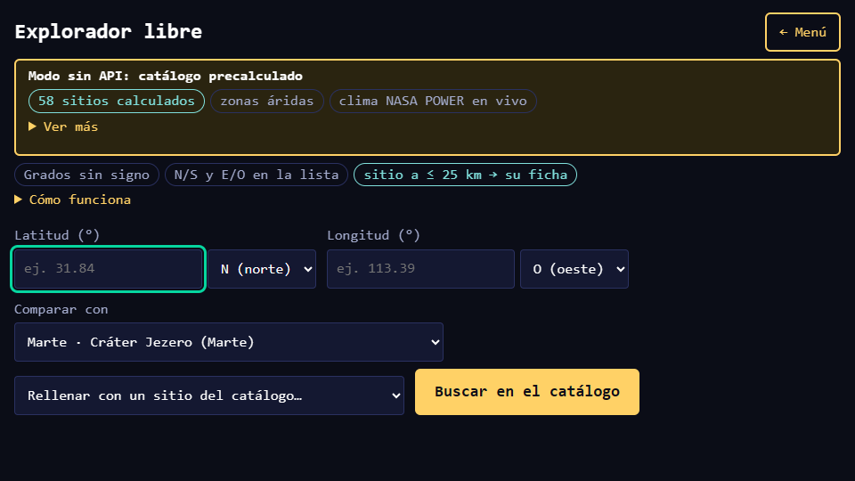
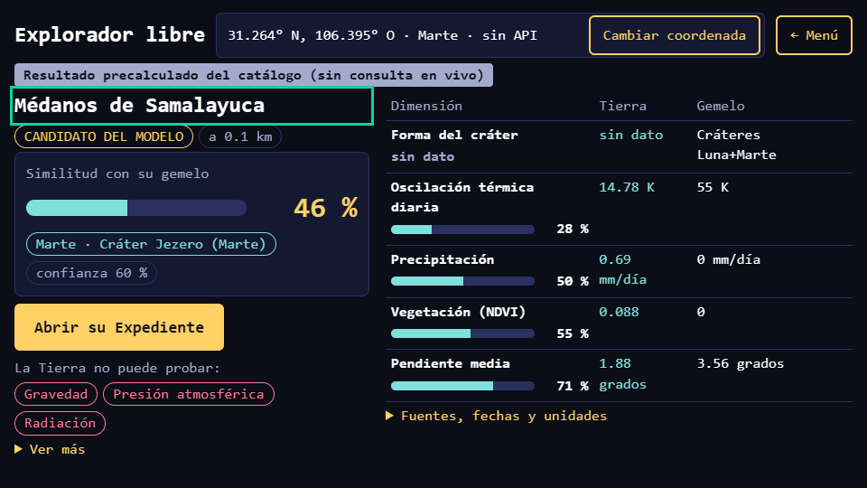

# Prueba de los 3 segundos · pantallas del frente expediente

> Dueño: frente expediente (Boot, Menú, Cómo jugar, Expediente, Explorador). Sigue `docs/juego/DISENO.md`.
> Objetivo: comprobar que cada pantalla **se entiende de un vistazo**: qué es y qué te pide hacer.

## Método

1. Busca a alguien que **no haya visto el juego** (otro equipo, mentor, familiar). Una persona por hoja; si se puede, 3 a 5 personas.
2. Muestra cada captura de `capturas_3s/` **3 segundos** (cuenta en voz baja o usa un temporizador) y luego **ocúltala**.
3. Pregunta siempre lo mismo, sin dar pistas: **"¿Qué te pide hacer esta pantalla?"**
   Si contesta rápido, puedes agregar: "¿Qué es lo más importante que viste?"
4. Escribe la respuesta **con sus palabras**, sin corregirla ni explicarle nada.
5. Marca la columna **¿Coincide?** con: ✅ (dijo lo esencial) · ⚠️ (a medias) · ❌ (no lo entendió o entendió otra cosa).
6. Al terminar todas las pantallas, anota los cambios propuestos en la última sección.

Las capturas son de la versión en español a 960×540, sin la API del modelo (como en la demo publicada).
Se regeneran con el recorrido Boot → portada → Menú → Nueva partida → Cómo jugar → elegir destino → Expediente → Explorador.

> Las capturas ya incluyen el rediseño de Menú, Cómo jugar, Elegir destino y Expediente (frente juego, DISENO.md §3).
> Si una pantalla cambia otra vez, vuelve a tomar su captura antes de la prueba.

## Resultados

Persona: ______________________ · Fecha: ____________ · ¿Había visto el juego antes? ☐ sí ☐ no

| # | Pantalla | Captura | Qué debería entender | Qué respondió la persona | ¿Coincide? |
|---|---|---|---|---|---|
| 1 | Boot (cargando) |  | El juego se llama MARSCEPTION y está cargando; la barra avanza. | | |
| 2 | Boot (portada) |  | Ya cargó: presiona una tecla o toca para empezar. | | |
| 3 | Menú |  | Empezar una partida nueva (opción principal); también hay explorador y cómo jugar. | | |
| 4 | Cómo jugar |  | Es un tutorial corto: primer paso, elegir un análogo en la Tierra; avanzar con "Siguiente". | | |
| 5 | Elegir destino |  | Elegir a dónde va el robot: Marte o la Luna. | | |
| 6 | Expediente |  | Comparar un sitio de la Tierra con el destino y gastar un ticket para probarlo. | | |
| 7 | Explorador (formulario) |  | Escribir una coordenada de la Tierra y buscarla. | | |
| 8 | Explorador (resultado) |  | Qué tan parecido es ese sitio a su gemelo (46 %) y abrir su Expediente. | | |

## Cambios propuestos

Anota aquí qué cambiar en cada pantalla donde marcaste ⚠️ o ❌ (qué confundió, qué se esperaba, idea de cambio).

| Pantalla | Qué confundió | Cambio propuesto | ¿Hecho? |
|---|---|---|---|
| | | | |
| | | | |
| | | | |
